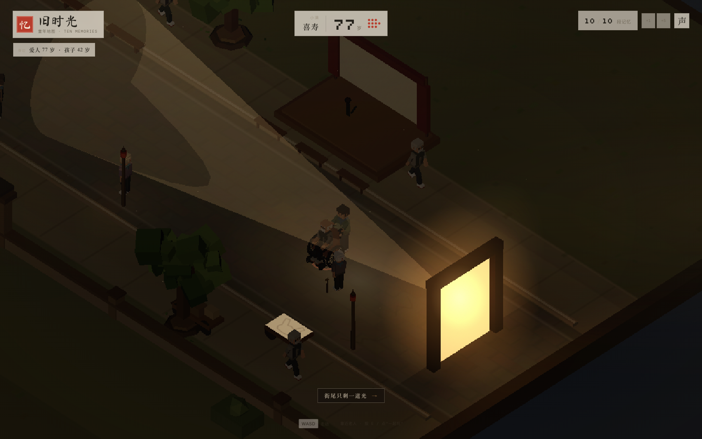
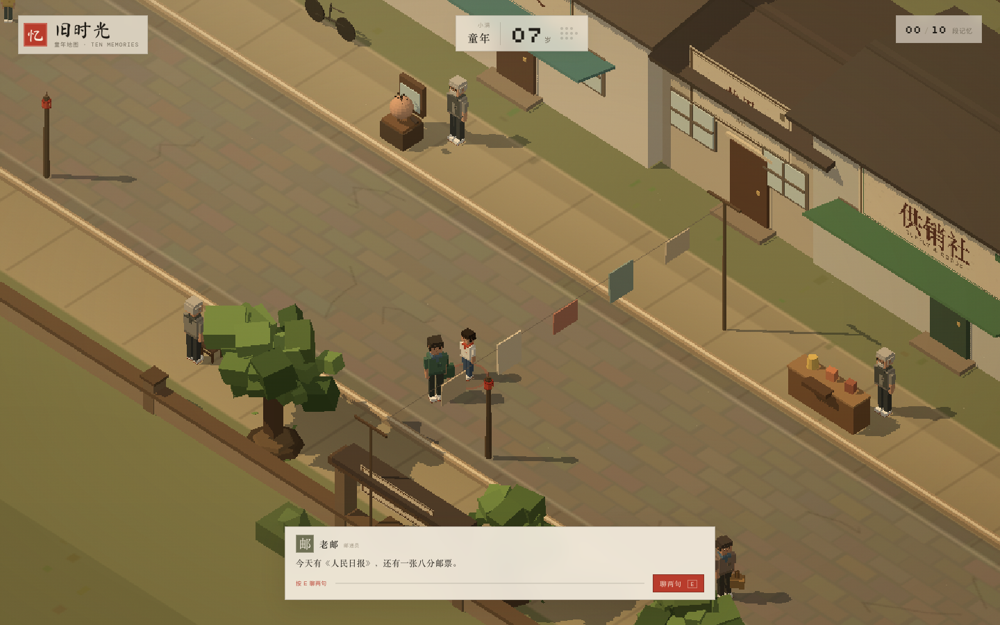
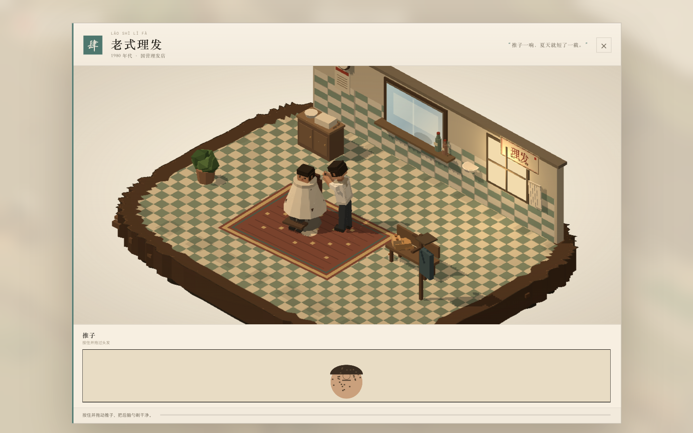
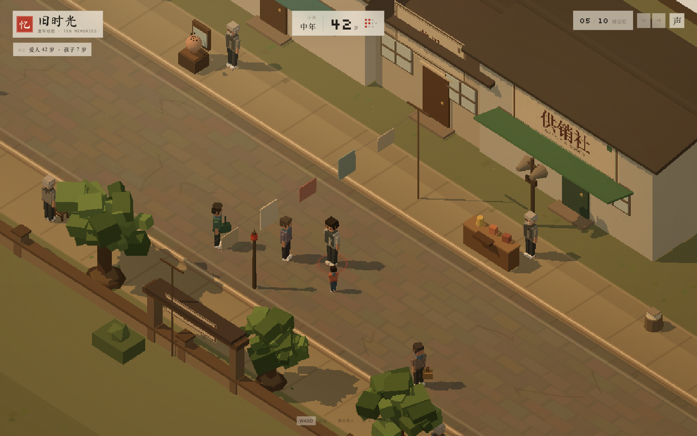
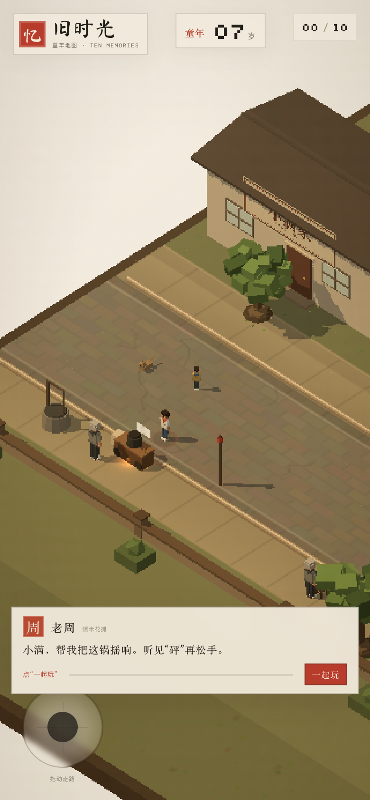

<p align="center">
  
</p>

<h1 align="center">旧时光 · 童年地图</h1>
<p align="center"><strong>Ten Memories — A Street Called Home</strong></p>
<p align="center"><em>一条街，十段旧时光，一辈子。</em></p>

<p align="center">
  <strong>DEEPSEEK 制作</strong> · <code>MADE BY DEEPSEEK</code>
</p>

<p align="center">
  <a href="https://sanbuphy.github.io/ten-memories-game/"><strong>▶ 在线游玩</strong></a>
  &nbsp;·&nbsp;
  <a href="https://github.com/sanbuphy/ten-memories-game/raw/main/ten-memories-game.html"><strong>下载单文件版</strong></a>
  &nbsp;·&nbsp;
  <a href="https://github.com/sanbuphy/ten-memories-game">GitHub</a>
</p>

<p align="center">
  <code>Web / WebGL</code> · <code>单人</code> · <code>约 15–25 分钟</code> · <code>简体中文</code> · <code>可离线</code>
</p>


---

> 七岁那年，你以为这条街会一直在。  
> 七十七岁，你回来把它再走一遍。

**《旧时光 · 童年地图》** 是一款由 **DeepSeek 制作** 的、可以在浏览器里走进去的短篇叙事游戏。

你扮演小满，从七岁走到七十七岁。爆米花车、小人书摊、理发椅、供销社、缝纫机、收音机、露天电影、皮影戏、糖画车……十件旧物长在同一条街上，十位老人守着它们。你走近，他们开口；你玩完一件，就长大七岁。老人会离开，街会变暗，爱人和孩子会出现，最后整条街只剩街尾一道光。

没有战斗，没有失败，没有需要背下来的操作。  
只有一条街，和一些你也许会想起的日子。

---

## 游戏特色

### 一条街，不是十个关卡

整个游戏是一块连续的老街街区：北边住家、店铺和院墙，南边树、长凳和摊子。没有切地图，没有“第一关 / 第二关”。你从西口走到东口，街坊在路边说话，广播、磨刀、冰棍、收废品和豆腐的叫卖从不同方向飘过来。

### 十段旧时光，十种手感

每件旧物都有一张独立的小游戏画面，画面就是那件旧物自己的立体小世界。摇锅、翻页、对光、推剪、拿货、踩针、调台、推铁环、摆皮影、画糖画——不是同一种“按绿区”换十次皮。

十个小游戏都压缩到 **2–3 次有效操作**：

- 爆米花：压两下
- 小人书：翻两页
- 供销社：拿两样
- 缝纫机：缝三针
- 皮影戏：摆两个姿势
- 露天电影：对光 1 秒
- 收音机：停稳 0.4 秒
- 滚铁环：坚持 1.8 秒
- 糖画：画到 260 单位
- 理发：剃掉 8 撮

小游戏里的 3D 动画也不是自己循环的：你操作到哪，场景就走到哪。

### 街上的人会换一代

- **7–21 岁**：街上有十一个小孩子，跑、跳、拍皮球；大人只有零星几个。
- **28–42 岁**：小孩子退到街角，四个提着公文包的上班族沿着街走来走去；赵婶、老马、刘姨、修鞋陈还在。
- **49–63 岁**：上班族走了，街上都是老人，而且一年比一年少。49 岁有 4 位老街坊、3 位广场舞老人；56 岁剩 3 位老街坊、2 位舞者；63 岁只剩 2 位老街坊、1 位舞者。旁边一直放着那台录音机。
- **70 / 77 岁**：普通街坊全部退场，只剩家人、还没收好的那件旧事，和街尾的光。

### 一条街的春天和深秋

- 一开始整条街是春天，树冠是绿的。
- 年纪越大，越靠东、越靠光之门的方向，树叶越黄、越稀，叶子会一片片落下来。
- 越靠西、越靠原来的入口，树越绿。花不再贴着南墙或人行道两侧。它们从西口路面冒出来，越靠西边那道“街与纸的接缝”越密：晚年时接缝处几乎堆成一面花墙，花还会越过纸边、在空白处堆成一个拱形花丘；西半幅路面也会被近五千朵花毯埋住，再往东慢慢变稀，东边光门附近没有花。
- 东边的道路也会一岁一岁褪掉：先是纹理变淡，靠近光门时只剩背景，最后什么都不剩，只有门和光。
- 77 岁走到西口，会看到春天还在那里，并出现一句：

> **新的轮回又要开始了。**

你可以从这里回到七岁，也可以“再走一会儿”。

### 一生都在路上

- **7–21 岁**：一个人走，街道是亮的。
- **28 岁**：成家，爱人出现。
- **35 岁**：孩子出生，抱在爱人怀里。
- **42 岁**：孩子 7 岁，第一次自己跟在你身后。
- **49 / 56 / 63 岁**：孩子 14、21、28 岁；63 岁起，他会主动走到你左侧，扶住你的胳膊，腿也跟着你的步子走。
- **70 岁**：孩子 35 岁，仍然搀着你；你的膝盖开始发沉。
- **77 岁**：你坐进轮椅，孩子走到身后推着你。速度很慢，靠近街尾那道光时几乎是一点点挪过去。

爱人留着一头长发，从深黑变灰、变白，后来戴上老花镜、拄拐；孩子每个阶段换身高、衣服、发型和步态。

### 天色跟着年龄暗下去

从早晨的暖光，到午后偏金、黄昏、暮色，再到 77 岁的深夜。  
70 岁前后，国营理发店、小酒家和供销社的窗子还亮着，街灯一盏盏开着；到 77 岁，店里熄灯、街灯熄灭，整条街只剩街尾一扇亮着的门，一道光；门框、树、你、爱人和孩子的影子都会被拉长。光会呼吸，画面右缘会浮起很淡的暖光，底部写着：

> 街尾只剩一道光 →

### 声音也会变老

所有音乐和声音都为这条街生成，没有使用受版权保护的录音。

- 原创钢琴主题按年龄分成 **年轻 / 中年 / 老年** 三套编曲。
- 每一段继续微调播放速度、音量和街边叫卖的音量。
- 70 岁以后，鸟叫、风声、街边叫卖、BGM 都退场，只剩钟表的走针声。
- 77 岁，钟表声也停了；只有靠近街尾那扇门时，才听得见一声很低的钟响。离门越远越听不见，街中间是安静的。
- 记忆画面的八音盒在老年时也会放慢。
- 供销社大喇叭、磨刀、冰棍、收废品、豆腐的叫卖都有各自的听觉范围——走近才听得见，走远就淡出。
- 右上角 **声 / 静** 可以一键静音；建议戴耳机。

### 一个安静的结尾

街尾有一道光。走进去之前，你要回答一个问题：

> 想重新活这一辈子吗。

你可以选 **想**，回到七岁再走一遍；也可以选 **已经足够**。

选“已经足够”后，人物会自己慢慢走进光里，镜头绕到侧面，整屏被暖白吞没，出现“像第一次睁开眼”和心跳一样的呼吸圆环——然后才出现那段关于记忆与一生的文字尾声。

---

## 在线游玩

### ▶ [现在开始](https://sanbuphy.github.io/ten-memories-game/)

- 电脑：Chrome / Edge / Safari / Firefox。
- 手机：竖屏或横屏都可以；横屏时开场也会自动收成紧凑版，不会挡住“开始走”。左下摇杆走路，按钮和对话框避开安全区。
- 在线版首屏只加载约 **1 MB** 的页面、样式和程序；13 段音乐在开始走之后按需加载，不会再为了等音频卡在加载页。
- 手机横屏、竖屏都已适配；第一次打开如果网络慢，按钮会提示“还在加载”。
- 不需要登录，不需要联网存档；刷新会从头开始。
- 游戏没有自动存档，建议一次走完。

### 下载离线版

[**ten-memories-game.html**](https://github.com/sanbuphy/ten-memories-game/raw/main/ten-memories-game.html)（约 6.2 MB，音频、字体、程序全部内联）

下载后双击即可用浏览器打开；不依赖任何外部资源，也不需要服务器。

---

## 操作

| 操作 | 电脑 | 手机 |
| --- | --- | --- |
| 走路 | `WASD` / 方向键 | 左下摇杆 |
| 和街坊 / 老人说话 | `E` / `Enter` | 右下「聊两句」 |
| 进入小游戏 | `E` / `Enter` / 点击「一起玩」 | 点击「一起玩」 |
| 小游戏内操作 | 鼠标 / 空格 / 方向键 | 触摸 / 按钮 |
| 静音 | 右上角「声 / 静」 | 右上角「声 / 静」 |
| 查看项目 | 右上角 GitHub 按钮 | 右上角 GitHub 图标 |

右上角的 **+1 / +5** 是测试快进，可以直接跳过若干段记忆，方便看后面的年龄、家人和结尾。

---

## 十段旧时光

十段记忆没有固定顺序，你走到哪件旧物旁边，就可以先做哪一件。每完成一件，年龄增加七岁。

| # | 记忆 | 守着它的人 | 你要做的事 |
| --- | --- | --- | --- |
| 01 | 爆米花 | 老周 | 把锅摇响，等那声“砰” |
| 02 | 小人书 | 陈爷爷 | 翻两页，天就黑了 |
| 03 | 老式理发 | 王师傅 | 推子推过后脑勺 |
| 04 | 供销社 | 赵姨 | 拿两样东西，票递过去 |
| 05 | 滚铁环 | 老孙 | 让铁环留在街心 |
| 06 | 缝纫机 | 外婆 | 踩三针，收线 |
| 07 | 收音机 | 爷爷 | 把台调到评书 |
| 08 | 露天电影 | 老李 | 把光对准幕布 |
| 09 | 皮影戏 | 周师傅 | 摆两个影子姿势 |
| 10 | 糖画 | 老张 | 沿着底稿画一只兔子 |

街上的普通街坊也会说话：布票、的确良、永久自行车、邓丽君磁带、电子表、粮票……他们不给你任务，只是在你路过时，说一句那个年代的话。

---

## 一生，七个七年

| 年龄 | 发生的事 |
| --- | --- |
| 7 | 小满第一次走进这条街 |
| 14 | 个子长高，街变窄了一点 |
| 21 | 开始想街外面的事 |
| 28 | 成家，爱人出现 |
| 35 | 孩子出生，抱在爱人怀里 |
| 42 | 孩子 7 岁，跟在你身后跑 |
| 49 | 孩子 14 岁，开始问街外的事 |
| 56 | 孩子 21 岁，能和你并肩走 |
| 63 | 孩子 28 岁，主动走过来搀着你 |
| 70 | 孩子 35 岁；天色只剩暮色 |
| 77 | 孩子 42 岁，推着你的轮椅，走向最后一道光 |

走路速度会随年龄变慢：49 岁前正常，56 岁约 9.0，63 岁约 7.6，70 岁约 5.35，77 岁约 3.1；靠近最后那道光时约 1.6。孩子会跟着你的速度走，不会把你甩在后面。

---

## 画面

| 街坊 | 旧物 |
| --- | --- |
|  |  |
| **“我爸从上海带回来一块电子表。”** | **每件旧物都有自己的立体小世界。** |

| 一家人 | 手机 |
| --- | --- |
|  |  |
| **孩子七岁那年，第一次跟在你身后。** | **同一条街，在手机上也可以走。** |

| 最后一道光 |
| --- |
|  |
| **77 岁，孩子推着轮椅。街尾只剩一道光。** |

---

## 结局（剧透）

<details>
<summary>点开看结尾流程</summary>

选了“已经足够”之后：

1. 人物自己慢慢走向街尾门里的光，镜头绕到侧面。
2. 整屏被暖白吞没，越来越亮。
3. 白屏上出现“光里 / 像第一次睁开眼”，还有一圈心跳一样的呼吸圆环。
4. 靠近门时，钟声从很轻开始慢慢变响；白屏退去后，所有人坐在街心的凳子上，十件旧物围在身边，前面站着一位摄影师。闪光灯亮过，照片淡进文字尾声：

> 后来我才知道，人记住的并不是一条街。  
> 是爆米花炸开的那一秒，是幕布上的一束光，是有人站在门口喊你回家吃饭。  
>
> 那些教过你手艺的人，后来一个个走远了。你没有留住他们，只留住了他们教你的那一点手艺。  
>
> 我们以为自己在保存过去。其实是过去替我们保存了那些还会心软的地方。  
>
> 一生并没有多长。只是把一些平常的日子，反复想了很多年。  
>
> 街会拆，人会走，声音会散。可只要还有人记得，那条街就还在。

最后落在：

> 旧时光不是回去的地方。  
> 是带着走的东西。


</details>

---

## 制作

《旧时光 · 童年地图》想做的不是“怀旧素材拼贴”，而是一条能走进去的街。

- 整条街是一块 88 × 36 的连续正交等距场景；房子、树、院墙、摊位、电线、晾衣绳和路灯都是程序化几何体，没有导入外部模型。
- 十个记忆画面复用原来的十个小世界；任务进度会驱动场景自己的时间轴，而不是让 3D 在背后空转。
- 天色、雾、太阳角度、环境光和最后那盏门灯，一起跟着年龄走。
- 家人的位置、步态和搀扶方向都按玩家真实朝向计算。
- 音频是原创钢琴主题、合成环境声和中文语音合成，没有采样任何现有歌曲或影视录音。
- 在线版把程序、字体和音频拆开，首屏更轻；离线版再把它们全部内联成一个文件。

### 技术

- Three.js r186 · 正交等距相机 · WebGL
- 原生 ES Modules + esbuild 单文件打包
- HTMLAudio / WebAudio 空间音量
- 桌面与移动端浏览器
- 无后端、无账号、无追踪

### 源码运行

如果你拿到的是源码目录：

```bash
cd game
python3 -m http.server 4176
# 打开 http://127.0.0.1:4176/game/
```

单文件离线版：

```bash
open ../ten-memories-game.html
```

### 本地调试模式

通过 `localhost` / `127.0.0.1` 打开时，右下角会出现 **DEBUG** 面板（线上不会显示）：

- 选年龄阶段
- 选街道、任意一段记忆、全家福、文字尾声、白屏新生、结局卡或完整结尾
- 选“直接进入”或“完整播放后面”
- 点“载入这个场景”即可跳到对应过程

---

## 制作名单

- **制作：DeepSeek**
- 设计 / 程序 / 场景 / 文字 / 声音：**DeepSeek**
- 引擎：**Three.js**（MIT）
- 字体：马善政毛笔楷书、Silkscreen、DM Mono（开源字体）
- 所有场景、角色、音乐与文字为本项目原创；没有使用受版权保护的录音或现成游戏素材。

## 内容提示

没有战斗、血腥或突然惊吓。故事涉及衰老、离别与死亡，但整体是安静的。

## 许可

© 2026 DeepSeek。保留所有权利。

游戏、场景、角色、音乐与文字由 DeepSeek 制作；未经许可请勿商用、重新打包发布或冒充原创。欢迎在 GitHub Issues 里反馈，或把链接分享给会想起这条街的人。

## 版本

**v1.0** · 2026-10-22

- 一条连续的 1980 年代老街
- 十段记忆 / 十种小游戏，全部压缩到 2–3 次有效操作
- 7 岁到 77 岁的完整一生：孩子、长发爱人、搀扶与轮椅
- 街坊换了一代又一代：小孩 → 上班族 → 老人与广场舞 → 只剩家人
- 南侧花坡随年龄铺开；东侧树秃、落叶、道路逐渐褪成背景
- 随年龄变暗的天色；70 岁前后店铺和街灯亮着，77 岁全部熄灭，只剩最后一道光
- 西口“新的轮回”
- 70 岁只剩钟表走针；77 岁只在光门附近听见渐强的钟响
- 走进光里、白屏、新生、街心全家福坐好、摄影师按下快门，最后才出现文字尾声
- 手机横竖屏适配、安全区摇杆、加大“一起玩”按钮
- 右上角 +1 / +5 测试快进和 GitHub 入口
- 轻量在线版（程序约 1 MB，音乐按需加载）与 6.2 MB 单文件离线版
- README、页面 metadata、description 与关键词均标注 **DeepSeek 制作**

## 反馈

- 在线玩：[sanbuphy.github.io/ten-memories-game](https://sanbuphy.github.io/ten-memories-game/)
- 仓库 / Issues：[github.com/sanbuphy/ten-memories-game](https://github.com/sanbuphy/ten-memories-game)
- 如果页面第一次打开比较慢，是在下载约 7 MB 的内联音频；稍等几秒即可。

---

<p align="center">
  <sub>“街会拆，人会走，声音会散。可只要还有人记得，那条街就还在。”<br><strong>DeepSeek 制作 · MADE BY DEEPSEEK</strong></sub>
</p>
